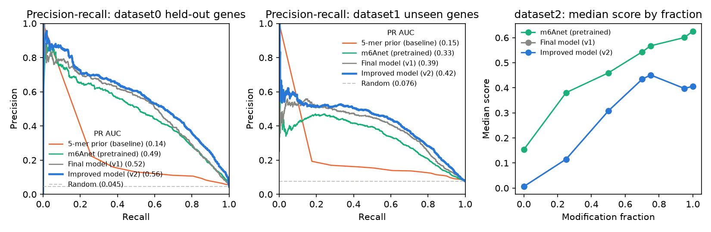

# DSA4262 Team Project 2026, Dolly
**Predicting m6A RNA modifications from direct RNA-Seq**

In this project, we Dolly predict, for every candidate site in a transcript, the probability that it carries an **m6A** modification.
The input is Oxford Nanopore direct RNA-Seq data processed by m6Anet's `dataprep` (`data.json`). The output is a CSV
with `transcript_id,transcript_position,score`. The final model (**v2**) beats simple baselines and the published
tool m6Anet on held-out data.

**[Step-by-step guide for student evaluation (HOW_TO_RUN)](docs/HOW_TO_RUN.md)** · **[How the model was built](docs/model_development.md)**

---

## Quick start: predict on the test data (AWS Ubuntu, ~5 min)

```bash
# 1. install (once)
sudo apt update && sudo apt install -y git python3-venv python3-pip
git clone https://github.com/umarmadbi/dsa4262-teamproject-dolly.git
cd dsa4262-teamproject-dolly
bash setup/setup_env.sh                 # creates .venv/ and installs the packages (~3-5 min)
source .venv/bin/activate               # repeat in every new terminal

# 2. predict on the included test data (500 sites, a few seconds)
python scripts/predict.py --json data/sample/sample.json.gz --out results/my_sample_predictions.csv

# 3. check the output
head -3 results/my_sample_predictions.csv
```

Expected output:

```
transcript_id,transcript_position,score
ENST00000000233,244,0.0006933723387158056
ENST00000000233,261,0.0007799455941661969
```

`score` is the predicted probability (0-1) that the site is m6A-modified. To score your own data, replace
`--json` with any m6Anet `data.json` or `data.json.gz` (one sequencing run per call). Requirements: Python 3.10-3.12
on Linux or macOS (Windows: `setup\setup_env.bat`); no GPU needed.

The [step-by-step guide](docs/HOW_TO_RUN.md) adds a full output-format check, scoring a full SG-NEx run from AWS S3,
training, and troubleshooting.

**Train a model** (optional; needs the course training data in `data/data0/`, ~25-40 min):

```bash
python scripts/train.py --data data/data0/dataset0.json.gz data/data0/data.info.labelled --out models/my_model.joblib
```

---

## Results

Held-out data that was never used for any modelling decision (confidence intervals in
[docs/model_development.md](docs/model_development.md)):

| Model | dataset0 held-out genes<br>ROC AUC / PR AUC | dataset1 unseen transcripts<br>ROC AUC / PR AUC |
|---|---|---|
| Random classifier | 0.52 / 0.048 | 0.50 / 0.083 |
| 5-mer prior (simple baseline) | 0.80 / 0.14 | 0.72 / 0.16 |
| LightGBM on site features | 0.92 / 0.48 | 0.83 / 0.36 |
| Pretrained m6Anet | 0.93 / 0.49 | 0.83 / 0.35 |
| v1 (earlier model) | 0.93 / 0.52 | 0.86 / 0.40 |
| **v2 (final model)** | **0.95 / 0.56** | **0.88 / 0.43** |

PR AUC is the main metric: only ~4.5% of sites are modified, so a random model scores about 0.045.



### How we evaluated

- **Split by gene**, never randomly: positives cluster within genes, and a random split inflates PR AUC.
- **One frozen test set** (20% of dataset0 genes), used once at the end; all choices come from cross-validation.
- **Cross-run test** on dataset1 transcripts the model never saw, to check robustness to batch effects.
- **PR AUC and ROC AUC** with gene-level bootstrap 95% CIs, never accuracy.

Data pitfalls and how the model handles them: [docs/eda_findings.md](docs/eda_findings.md).

### The model

A read-level LightGBM scores individual reads (the multiple-instance idea behind m6Anet), and the read scores are
pooled per site. A site-level LightGBM combines them with summaries of the signal distribution (centred per 5-mer),
the 7-mer sequence and the scores of neighbouring sites. v2 adds transcript-structure features from Ensembl 91 (e.g.
distance to the stop codon) and averages three seeds.

---

## Repository layout

Every folder has a README that explains each file.

| Folder | What it contains |
|---|---|
| [`setup/`](setup/) | Install scripts and package lists |
| [`scripts/`](scripts/) | **`predict.py`** and **`train.py`**, plus data-preparation tools |
| [`src/m6a/`](src/m6a/) | The shared Python library: data loading, features, models, evaluation |
| [`models/`](models/) | The trained models (v2 final, v1 earlier) |
| [`data/`](data/) | **`data/sample/`**: the small test data set; the full datasets are not committed |
| [`resources/`](resources/) | Ensembl 91 transcript annotation used by v2 |
| [`experiments/`](experiments/) | The numbered studies (01-11) behind every result |
| [`results/`](results/) | Metrics, logs and example predictions |
| [`notebooks/`](notebooks/) | Exploratory data analysis |
| [`docs/`](docs/) | Run guide, write-ups and figures |

---

## Team

| Member | Main contributions |
|---|---|
| Umar | Repo setup, EDA, shared library, v1 model, train/predict scripts, documentation (Hackathon logs, report) |
| Hamzah | m6Anet benchmark, v2 model, SG-NEx analysis (Task 2), dashboard data and hosting, documentation (report) |
| Joshua | Dashboard website and the "Ask Dolly" chat interface |
| Nitish | Model for intermediate leaderboard, deployment of the Dolly chatbot backend (Cloudflare Workers, Gemini, Turnstile) and its tests |
