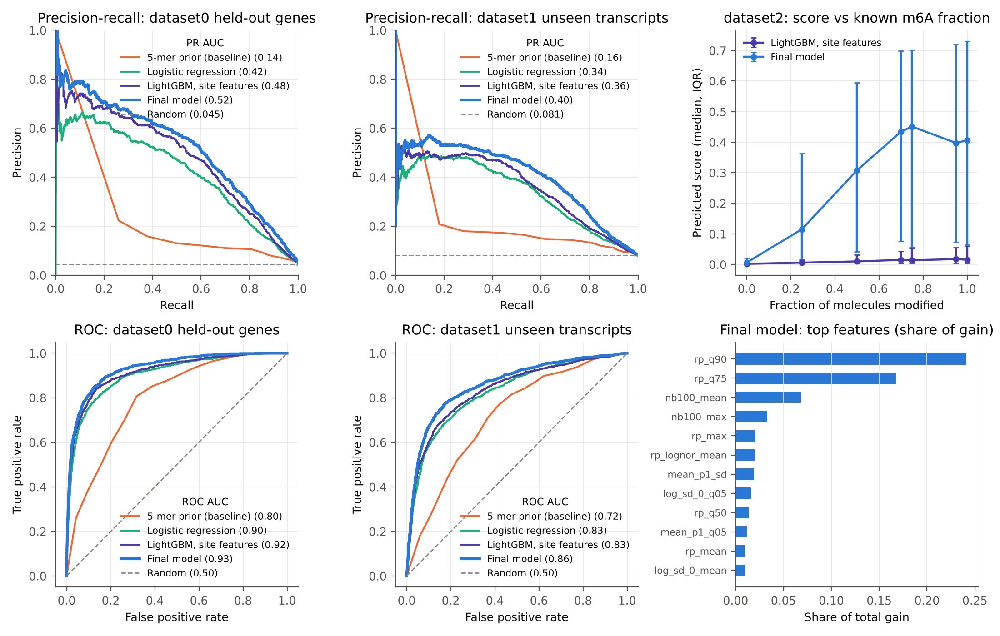

# Predicting m6A RNA modifications from direct RNA-Seq data

DSA4262 Team Project (2026), team **Dolly**.

We predict, for every candidate site in a transcript, the probability that it carries an **m6A** modification. The
input is Oxford Nanopore direct RNA-Seq signal, already processed by m6Anet's `dataprep` (`data.json`); the labels
come from m6ACE-Seq (`data.info`). We measure performance with **ROC AUC and PR AUC** and compare against simple
baselines and the published tool **m6Anet**.

| Task | What it asks for | Where it is | Status |
|---|---|---|---|
| **Task 1** | A training script and a prediction script that output `transcript_id,transcript_position,score` | `scripts/train.py`, `scripts/predict.py`, `src/m6a/` | Done (v1 submitted model; v2 improved model available) |
| **Task 2** | Predict m6A on all SG-NEx direct RNA-Seq runs, compare cell lines | `experiments/12_sgnex_m6anet_compare.py`, [docs/sgnex_task2.md](docs/sgnex_task2.md) | Done (23 runs, 7 cell lines) |
| **Task 2** | Interactive visualisation | `viz/` ([viz/README.md](viz/README.md)) | Built; GitHub Pages hosting still needs to be enabled by the repo owner |

---

## Contents

1. [Start here: what to read for what you want](#1-start-here)
2. [Results at a glance](#2-results-at-a-glance)
3. [Repository map](#3-repository-map)
4. [Setup (server, clone, data, Python)](#4-setup)
5. [Task 1: train and predict](#5-task-1-train-and-predict)
6. [Task 2: SG-NEx predictions and cell-line comparison](#6-task-2-sg-nex-predictions-and-cell-line-comparison)
7. [The interactive visualisation](#7-the-interactive-visualisation)
8. [How we evaluate (rules every experiment follows)](#8-how-we-evaluate)
9. [What is not in git](#9-what-is-not-in-git)
10. [How we work together (Git)](#10-how-we-work-together-git)
11. [Deliverables, deadlines and to-do](#11-deliverables-deadlines-and-to-do)
12. [Who did what](#12-who-did-what)

---

## 1. Start here

| I want to... | Go to |
|---|---|
| Score a new `data.json` with our model | [Section 5](#5-task-1-train-and-predict): `python scripts/predict.py ...` |
| Understand how the model works and why | [docs/model_development.md](docs/model_development.md) (every experiment, every number) |
| See what the data looks like and its pitfalls | [docs/eda_findings.md](docs/eda_findings.md), `notebooks/01_EDA.ipynb` |
| See the SG-NEx / cell-line results (Task 2) | [docs/sgnex_task2.md](docs/sgnex_task2.md) |
| Open the dashboard | [Section 7](#7-the-interactive-visualisation) |
| Find which script wrote a result file | [results/README.md](results/README.md) |
| Re-run an experiment | [experiments/README.md](experiments/README.md) |
| Log in to the team AWS machine | [docs/connect_to_server.md](docs/connect_to_server.md) |
| Write the report's AI-use section | [docs/ai_use_log.md](docs/ai_use_log.md) (add your entries) |
| See every document in one list | [docs/README.md](docs/README.md) |

---

## 2. Results at a glance

Held-out data, never used for any modelling decision (details and confidence intervals in
[docs/model_development.md](docs/model_development.md)):

| Model | dataset0 held-out genes ROC / PR | dataset1 unseen transcripts ROC / PR |
|---|---|---|
| Random | 0.52 / 0.048 | 0.50 / 0.083 |
| 5-mer prior (simple baseline) | 0.80 / 0.14 | 0.72 / 0.16 |
| LightGBM on site features | 0.92 / 0.48 | 0.83 / 0.36 |
| Pretrained m6Anet | 0.93 / 0.49 | 0.83 / 0.35 |
| **v1** (`models/m6a_model.joblib`, current default) | **0.93 / 0.52** | **0.86 / 0.40** |
| **v2** (`models/m6a_model_v2.joblib`) | **0.95 / 0.56** | **0.88 / 0.43** |

PR AUC is the main metric: only ~4.5% of sites are modified, so a random model scores ~0.045 and accuracy is
meaningless. v2 beats v1 on every test set with bootstrap CIs above zero.

On the 23 unlabelled SG-NEx runs (Task 2), v2 and m6Anet agree moderately (median Spearman 0.64; about two-thirds of each
method's calls are shared), both put their calls near the stop codon and in 3' UTRs and on the GGACT motif, as expected for m6A. See
[docs/sgnex_task2.md](docs/sgnex_task2.md).



---

## 3. Repository map

```
.
├── README.md                    <- you are here
├── requirements.txt             <- Python packages for the main environment (.venv)
├── environment_m6anet.yml       <- separate conda env for running m6Anet (Python 3.8)
├── setup_env.sh / setup_env.bat <- create .venv (Linux/macOS/AWS, Windows)
│
├── src/m6a/                     <- SHARED LIBRARY: import this, don't copy-paste it
│   ├── io.py                    <- streaming json parser, label loading
│   ├── features.py              <- read-distribution features, k-mer centring, neighbour context
│   ├── annotation.py            <- transcript-structure features from Ensembl 91 (v2)
│   ├── models.py                <- baselines, candidate models, final ReadStackModel, SeedEnsemble (v2)
│   ├── pipeline.py              <- loading helpers shared by train.py / predict.py
│   └── evaluation.py            <- gene-grouped splits, ROC/PR AUC, gene-level bootstrap CIs
│
├── scripts/                     <- COMMAND-LINE TOOLS (run from the repo root)
│   ├── train.py                 <- TASK 1: train a model from data.json + labels
│   ├── predict.py               <- TASK 1: data.json -> transcript_id,transcript_position,score
│   ├── build_features.py        <- cache a dataset's features for the experiments
│   ├── build_annotation.py      <- Ensembl 91 GTF -> resources/ensembl91_transcripts.csv.gz
│   ├── build_viz_data.py        <- TASK 2: SG-NEx predictions -> viz/site/data/
│   └── parse_to_parquet.py      <- data.json.gz -> simple site-level table (EDA)
│
├── experiments/                 <- NUMBERED STUDIES 01-12 behind every result (see experiments/README.md)
├── models/                      <- TRAINED MODELS
│   ├── m6a_model.joblib         <- v1 (2.5 MB), default of predict.py
│   └── m6a_model_v2.joblib      <- v2 (16 MB): + Ensembl transcript-structure features, 3 seeds
├── resources/
│   └── ensembl91_transcripts.csv.gz <- per-transcript annotation used by v2
├── results/                     <- METRICS AND LOGS (indexed in results/README.md)
│   └── sklearn_comparison/      <- predictions from the alternative pipeline
│
├── viz/                         <- TASK 2 DASHBOARD (plain HTML/JS, see viz/README.md)
│   ├── site/                    <- the page itself + data/ (one JSON per run)
│   └── tests/                   <- node tests for the data and parsing
├── .github/workflows/pages.yml  <- tests viz/ and publishes it to GitHub Pages on push to main
│
├── alternatives/
│   └── sklearn_comparison/      <- Nitish's independent scikit-learn/XGBoost pipeline (see its README)
├── notebooks/01_EDA.ipynb       <- exploratory data analysis
├── docs/                        <- WRITE-UPS AND FIGURES (indexed in docs/README.md)
└── data/                        <- datasets (NOT committed, see data/README.md); data/sample/ is a small test set
```

Rule of thumb: **reusable code** goes in `src/m6a/`, **things you run** go in `scripts/` (deliverables) or
`experiments/` (studies), **outputs** go in `results/` or `docs/figures/`, **explanations** go in `docs/`.

---

## 4. Setup

### 4.1 Log in to the team AWS machine
Follow **[docs/connect_to_server.md](docs/connect_to_server.md)**. It covers the shared `.pem` key on Windows and
macOS, VS Code Remote-SSH, uploading data, and the rules for sharing one machine.

### 4.2 Clone the repo into your own folder on the server
Everyone logs in as the same `ubuntu` user, so each person works in a separate folder:

```bash
mkdir -p ~/<yourname> && cd ~/<yourname>
git clone https://github.com/umarmadbi/dsa4262-teamproject-dolly.git
cd dsa4262-teamproject-dolly

# set your identity for THIS repo only (no --global, the machine is shared)
git config user.name  "Your Name"
git config user.email "you@example.com"
```

### 4.3 Link the shared data
The datasets live once on the server in `~/data/`. Link them into your clone instead of copying:

```bash
for d in data0 data1 data2; do ln -s ~/data/$d data/$d; done
ls data/data0      # should show data.info.labelled and dataset0.json.gz
```

On your own laptop, copy the `data0`, `data1` and `data2` folders into `data/` instead. See
[data/README.md](data/README.md) for the expected layout and file formats.

### 4.4 Create the Python environment
```bash
sudo apt update && sudo apt install -y python3-venv python3-pip   # once per machine
bash setup_env.sh                                                 # once per clone
source .venv/bin/activate                                         # every session
```
In Jupyter / VS Code choose the kernel **"Python (DSA4262)"**. There is no plain `python` on the server; inside the
activated venv `python` works, otherwise call `.venv/bin/python`.

Running m6Anet itself (experiments 07-08 and the SG-NEx comparison) needs Python 3.8 in a separate conda env:
```bash
conda env create -f environment_m6anet.yml && conda activate m6anet
```

### 4.5 Run the EDA (optional)
Open `notebooks/01_EDA.ipynb` and run all cells. The first run parses the json files (~7-10 min) and caches them in
`notebooks/cache/`; later runs take seconds.

---

## 5. Task 1: train and predict

```bash
source .venv/bin/activate

# predict with the shipped v1 model (small test set included in the repo)
python scripts/predict.py --json data/sample/sample.json.gz --out results/sample_predictions.csv

# predict with v2
python scripts/predict.py --json data/data1/dataset1.json.gz --model models/m6a_model_v2.joblib \
                          --out dataset1_predictions.csv --jobs 2

# retrain v1 from scratch (~10 min on 2 cores, ~2 GB RAM)
python scripts/train.py --data data/data0/dataset0.json.gz data/data0/data.info.labelled \
                        --out models/m6a_model.joblib

# retrain v2 (~25-40 min)
python scripts/train.py --v2 --data data/data0/dataset0.json.gz data/data0/data.info.labelled \
                        --out models/m6a_model_v2.joblib
```

- `predict.py` writes `transcript_id,transcript_position,score` (score = probability of m6A, 0-1) for every site in
  the json.
- Give it **one sequencing run per call**: neighbouring sites in the same transcript are used as context.
- `--jobs N` sets the number of CPU cores.
- `train.py` accepts `--data JSON LABELS` several times to train on more than one run.

### v1 vs v2: which model to use?
**v1** is the default of both scripts and the model the team agreed on. **v2** adds 16 transcript-structure features
from Ensembl 91 (distance to the stop codon and exon junctions, region, exon length, ...) and averages three seeds.
It is better on every test set (table above) but is not yet the team default. Transcripts that are not in Ensembl 91
(e.g. the synthetic dataset2) are scored by a v1-style fallback model inside the same file. v2 is ~4x slower to
predict (dataset1: 168 s vs 42 s). **Team decision needed:** switch the default to v2?

### The model in one paragraph
A read-level LightGBM scores individual reads (the multiple-instance idea behind m6Anet); the read scores are pooled
per site (quantiles, max, share of high-scoring reads, using at most 20 reads so depth does not matter). A final
LightGBM combines these with read-distribution summaries of the signal (quantiles of current, SD and dwell time at
-1/0/+1, centred on each 5-mer's typical level), the 7-mer sequence and the scores of neighbouring candidate sites
within 25/100 nt (m6A sites cluster). v2 adds the transcript-structure features. Details and every comparison:
**[docs/model_development.md](docs/model_development.md)**.

### Alternative pipeline
`alternatives/sklearn_comparison/` holds Nitish's independent pipeline (logistic regression, random forest,
histogram gradient boosting, XGBoost on simpler features). It uses a different test split, so its numbers are not
directly comparable with the table above. See [its README](alternatives/sklearn_comparison/README.md).

---

## 6. Task 2: SG-NEx predictions and cell-line comparison

Full write-up: **[docs/sgnex_task2.md](docs/sgnex_task2.md)**. The pipeline:

1. **Get the data.** The SG-NEx direct RNA-Seq runs (m6Anet `dataprep` output: `data.json`, `data.info`,
   `data.readcount`) are on the server in `data/sgnex/SGNex_<cell>_directRNA_replicate<r>_run<n>/`. Source:
   https://github.com/GoekeLab/sg-nex-data.
2. **Score every run with v2:**
   ```bash
   for d in data/sgnex/SGNex_*; do
     python scripts/predict.py --json $d/data.json --model models/m6a_model_v2.joblib \
                               --out results/sgnex_v2/$(basename $d).csv --jobs 2
   done
   ```
3. **Score every run with m6Anet** (m6anet env), output in `results/sgnex_m6anet/<cell>_rep<r>_run<n>/`.
4. **Compare:** `cd experiments && python 12_sgnex_m6anet_compare.py`.
5. **Update the dashboard:** `python scripts/build_viz_data.py --predictions results/sgnex_v2 --sgnex data/sgnex --model models/m6a_model_v2.joblib`,
   then commit `viz/site/data/`.

Main findings (23 runs, 7 cell lines: A549, H9, HEYA8, Hct116, HepG2, K562, MCF7):

- v2 and m6Anet agree moderately: median Spearman 0.64, median Jaccard overlap of calls 0.49.
- Calls of both methods are enriched near the stop codon (~43% vs 22% of all sites), in 3' UTRs and on DRACH motifs
  (GGACT ~7x).
- Call rate per run grows with sequencing depth (r = 0.76 for v2, 0.85 for m6Anet), so compare cell lines on
  shared sites or a common depth filter, not raw call rates.
- Runs of the same cell line agree only slightly more than runs of different cell lines.
- SG-NEx has no labels: this is agreement and plausibility, not accuracy.

---

## 7. The interactive visualisation

A plain HTML/JS dashboard in `viz/site/` (no build step, no frontend dependencies). It shows per-run score
distributions, call rates and read depth; a **Site explorer** to look up a gene or transcript; and **Compare samples**
for shared sites between two runs or two cell lines. Full documentation: [viz/README.md](viz/README.md).

### View it on your own computer
```bash
git pull
python3 -m http.server 8000 --directory viz/site
```
Open http://localhost:8000. It must be served over HTTP; opening `index.html` directly does not work. Only Python
is needed.

### View it on the AWS machine from your laptop
On the server, start it once (e.g. inside `tmux`), using a free port:
```bash
python3 -m http.server 8000 --directory viz/site
```
On your laptop, forward the port and open http://localhost:8000:
```bash
ssh -i <key.pem> -L 8000:localhost:8000 ubuntu@dsa4262-2610-teamproject-dolly.nus.cloud
```
The machine must be running, which costs budget: stop it in Ronin afterwards.

### Publishing (GitHub Pages)
`.github/workflows/pages.yml` runs the tests and publishes `viz/site` on every push to `main` that touches `viz/`.
The first deployment failed, most likely because Pages is not enabled yet. **The repo owner** (only they can change
repo settings) must go to Settings -> Pages -> Source: "GitHub Actions" and re-run the workflow from the Actions tab. Alternatives that need no repo settings: deploy the `viz/site`
folder with the Vercel CLI (`cd viz/site && vercel deploy --prod`) or Netlify Drop.

### Tests
`node viz/tests/core.test.mjs` (needs Node.js; not installed on the server, but GitHub Actions runs it).

---

## 8. How we evaluate

Every experiment follows these rules; results are only comparable if everyone does.

- **Split by gene.** Positives cluster within genes, so a random split leaks: it inflates PR AUC from 0.41 to 0.48.
  Use `m6a.evaluation.gene_split` / `StratifiedGroupKFold` by `gene_id`.
- **Frozen test set.** 20% of dataset0 genes (`results/test_genes_d0.csv`, 775 genes) is used once, at the end.
  All model choices come from cross-validation on the other 80%.
- **Cross-run test.** dataset1 transcripts absent from dataset0 test robustness to batch shift.
- **Metrics.** PR AUC (primary) and ROC AUC, never accuracy, with gene-level bootstrap 95% CIs.
- **Sanity check.** dataset2 (synthetic, known modification fractions): does the score rise with the fraction?

```python
import sys; sys.path.insert(0, "src")
from m6a.evaluation import gene_split, score
train_idx, test_idx = gene_split(df, test_size=0.2, seed=42)
print(score(y_test, p_test))   # {'roc_auc': ..., 'pr_auc': ..., 'pr_baseline': ...}
```

Pitfalls found in the EDA ([docs/eda_findings.md](docs/eda_findings.md)) and what we do about them:

| Pitfall | What we do about it |
|---|---|
| Only 4.5% of sites are positive | Report PR AUC (random ≈ 0.045) + ROC AUC; never accuracy |
| Positives cluster within genes | Split and cross-validate **by `gene_id`** |
| Current depends on the 5-mer (Simpson's paradox) | Centre per k-mer or give the model the k-mer |
| Batch shift between datasets | Validate across datasets (train data0 -> test unseen data1 transcripts) |
| Partial modification blurs averages | Use read-distribution features (quantiles, read-level model) |
| Outlier reads | Medians/quantiles |
| Read depth varies 20 to ~1,000 | At most 20 reads per site in the read-level model; no count features |

---

## 9. What is not in git

`.gitignore` blocks data, `results/*`, `models/*`, `cache/` and `*.json` (except `viz/site/data/`). So when you
clone you get code, docs, the two trained models, small result tables and the dashboard data, but **not**:

| Missing | Where it is | How to get it |
|---|---|---|
| Course datasets `data0-2` | `~/data/` on the server | [Section 4.3](#43-link-the-shared-data) |
| SG-NEx inputs `data/sgnex/` | `~/hamzah/dsa4262-teamproject-dolly/data/sgnex/` on the server | SG-NEx open data on AWS: [tutorial](https://github.com/GoekeLab/sg-nex-data/blob/master/docs/AWS_data_access_tutorial.md) |
| SG-NEx predictions (`results/sgnex_v2/`, 1.2 GB; `results/sgnex_m6anet/`, 9.9 GB) | `~/hamzah/dsa4262-teamproject-dolly/results/` | Re-run (hours) or read them there |
| Feature caches (`cache/`) | per clone | `scripts/build_features.py` |
| Ensembl 91 GTF / fasta | `cache/annotation/` per clone | Ensembl FTP, see `scripts/build_annotation.py` |

To commit a new result table or model on purpose: `git add -f results/<file>` and list it in
[results/README.md](results/README.md).

---

## 10. How we work together (Git)

1. **Always start with** `git checkout main && git pull`.
2. **Make a branch for your task:** `git checkout -b feature/<short-name>` (e.g. `feature/xgboost`).
3. Commit small, clear steps: `git add <files>` -> `git commit -m "Add per-5-mer normalisation"`.
4. `git push -u origin feature/<short-name>` and open a **Pull Request** on GitHub. Another team member reviews and
   merges it.
5. Never push data, `.pem` keys or tokens. `.gitignore` already blocks the common ones.

**Notebooks:** one notebook per person/experiment (`notebooks/02_<name>_<topic>.ipynb`). Notebooks merge badly, so
once code works, move it into `src/m6a/` so everyone uses the same parser, features and evaluation.

**Shared server:** everyone is the `ubuntu` user, so never use `git config --global` and never leave credentials in
shared files. Use separate ports when serving the dashboard.

---

## 11. Deliverables, deadlines and to-do

| Item | Due |
|---|---|
| Intermediate leaderboard | 7 Oct, 23:59 |
| Final leaderboard, report, code, visualisation | 28 Oct, 23:59 |
| Individual teamwork summary | 29 Oct, 23:59 |

- [x] `train.py`: train a model from `data.json` + `data.info`
- [x] `predict.py`: output `transcript_id,transcript_position,score` for new `data.json`
- [x] Benchmark vs random and simple baseline (ROC + PR curves, bootstrap CIs)
- [x] Benchmark vs m6Anet: our model beats pretrained m6Anet on both test sets
- [x] v2 model with transcript-structure features
- [x] Task 2: predictions on all 23 SG-NEx runs + comparison with m6Anet and across cell lines
- [x] Interactive visualisation (`viz/`)
- [ ] Decide: v1 or v2 as the submitted model
- [ ] Publish the visualisation (enable GitHub Pages, see [Section 7](#publishing-github-pages))
- [ ] Final leaderboard predictions
- [ ] Report (use [docs/ai_use_log.md](docs/ai_use_log.md) for the AI-use section)
- [ ] Make the repo **public** and test this README on a fresh Ubuntu machine

**Budget:** the team shares one AWS budget, which must also cover the peer evaluation. **Stop the machine in Ronin
when you finish a session.** Overspending costs 5% of the project grade.

---

## 12. Who did what

From the git history; please correct or add to it.

| Area | Who |
|---|---|
| Repo setup, EDA, setup docs, shared helpers, v1 model (read-stack), train/predict scripts | Umar |
| Alternative scikit-learn/XGBoost pipeline (`alternatives/sklearn_comparison/`) | Nitish |
| m6Anet benchmark, v2 model, SG-NEx analysis (Task 2), visualisation and its hosting | Hamzah |
| ... | Joshua: please add |
