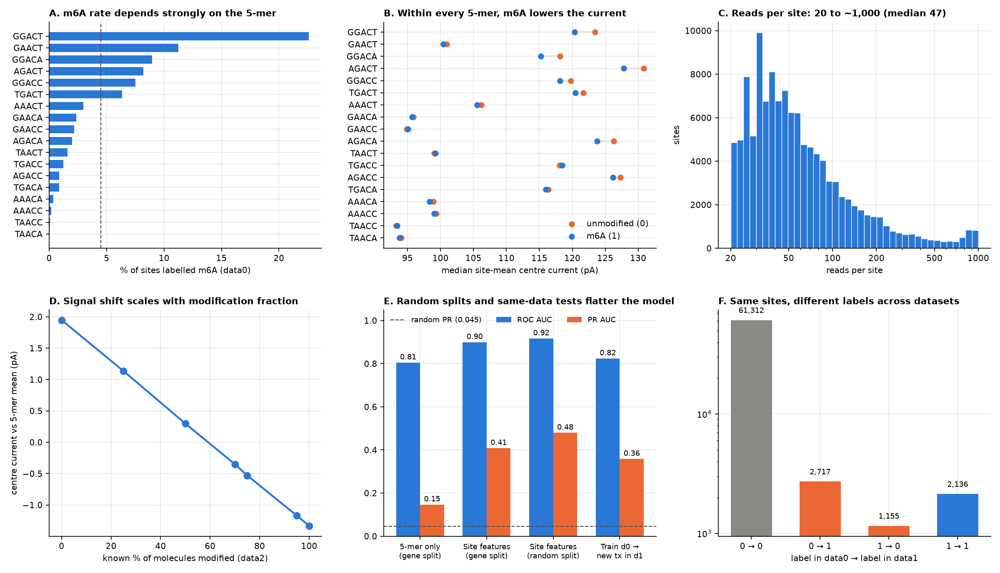

# EDA findings and the pitfalls they reveal

Source: `notebooks/01_EDA.ipynb`. Every model we build must address the pitfalls below; reviewers of a pull request should check them.

## The datasets

| Dataset | What it is | Sites | Positive rate |
|---|---|---|---|
| `data0` | Training data, HCT116 colon cancer cell line | 121,838 | 4.5% (5,475 sites) |
| `data1` | A second real dataset with labels | 90,810 | 7.3% |
| `data2` | 7 synthetic transcripts, label = known fraction of modified molecules | 7 × 189 | 0, 0.25, 0.5, 0.7, 0.75, 0.95, 1 |

Each site has 20–991 reads (median 47; data2 median 814). Each read has 9 features: dwell time, signal SD and mean current at positions −1, 0 and +1.

## Pitfalls

**1. Positives are rare.** Only 4.5% of sites in data0 are modified, so a model that always says "no" is 95.5% accurate. Use PR AUC (a random guess scores about 0.045) together with ROC AUC, and handle the imbalance with class weights. The positive rate also changes between datasets: it is 7.3% in data1.

**2. The 5-mer carries a lot of the signal.** The share of modified sites ranges from 0% for TAACA to 22.6% for GGACT (panel A). A model that sees only the 5-mer already gets ROC 0.81 and PR 0.15. That is our **simple baseline**, and the real model must clearly beat it.

**3. Raw current numbers point the wrong way (Simpson's paradox).** Across all sites, modified sites seem to have a higher current (effect size +0.36). Within every 5-mer, m6A *lowers* the current (−0.69, panel B), because the 5-mers most likely to be modified also have a high baseline current. Normalise current per 5-mer or give the model the 5-mer as an input.

**4. Only some features carry signal.** Within a 5-mer, the strongest signals are the centre mean current, the centre SD and the +1 position's mean current. Dwell time is weak.

**5. Modified sites cluster, so a random split inflates scores.** The top 10% of genes hold 61% of modified sites. If the previous site within 20 bases is modified, the next one is modified 30% of the time, against 3% otherwise. 954 genes have several transcripts sharing the same sites. A random split lifts PR AUC from 0.41 to 0.48 (panel E), and that gain is false. **Always split by `gene_id`.**

**6. The labels are noisy.** data0 and data1 share 67,320 sites, and the labels disagree on 3,872 of them (panel F). Some "negatives" are probably positives, so PR AUC has a ceiling. When testing on data1, drop transcripts/genes that also appear in data0, or the test leaks.

**7. Batch effects shift the signal between datasets.** For the same unmodified 5-mers, data1's current is 0.2–0.4 pA lower and its spread is higher (4.86 vs 4.63). Training on data0 and testing on new transcripts in data1 drops PR AUC from 0.41 to 0.35. The leaderboard data may come from another cell line, so evaluate across datasets, not just within data0.

**8. Partly modified sites are hard to detect.** In data2, the current shift grows linearly with the fraction of modified molecules (+1.9 pA at 0% to −1.3 pA at 100%, panel D). Features describing the spread of reads (quantiles, share of low-current reads) should beat plain means.

**9. Read depth can differ a lot at test time.** Median 47 reads in training vs 814 in data2. Read count does not predict the label, but features that depend on it (raw count, sums) won't transfer, and averages from few reads are noisy.

**10. Some reads are extreme outliers.** The largest centre SD is 181, while 99.9% of reads are below 17. Use medians/quantiles or clip.

## Checklist for every model / pull request

- [ ] Split by `gene_id` (`m6a.evaluation.gene_split`), same seed as everyone else
- [ ] Report ROC AUC **and** PR AUC, with the PR baseline (positive rate)
- [ ] Compared against the 5-mer-only baseline
- [ ] Current features made relative to the k-mer (or k-mer included)
- [ ] No features that scale with read count
- [ ] Robust summaries (median/quantiles) or clipping for outliers
- [ ] Imbalance handled (class weights / resampling), threshold-free metrics used
- [ ] Cross-dataset check: train data0 → test data1 transcripts not in data0

## Baselines so far (gene split, HistGradientBoosting)

| Model | ROC AUC | PR AUC |
|---|---|---|
| 5-mer only | 0.81 | 0.15 |
| Site summary features (mean/SD/median) + 7-mer | 0.90 | 0.41 |
| Same, random split (leaky, for comparison only) | 0.92 | 0.48 |
| Train data0 → unseen transcripts in data1 | 0.82 | 0.35 |
